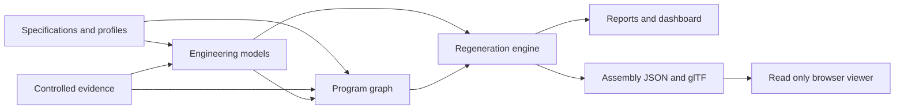

# Architecture

BuildSlate connects engineering inputs to generated reviews without allowing a calculated result or polished drawing to become evidence by appearance alone. The Python package operates on a repository data checkout; the browser viewer reads generated files and cannot change them.

## Authority and data flow

| Layer | Examples | Authority boundary |
| --- | --- | --- |
| Product intent | `specs/`, `configs/` | Describes targets and profile choices; it is not proof that a design meets them. |
| Controlled evidence | Supplier responses, calibration records, EVT0 runs, pilot results | Received bytes and receipts are preserved through intake; review determines their evidence status. |
| Engineering models | Calculations, CAD envelopes, integration contracts | Derives consequences from declared inputs; estimates do not become measurements. |
| Generated views | `reports/`, program dashboard, assembly JSON and glTF | Presents source state and model output; it cannot approve a part or gate. |

The [program manifest](engineering/program/program_model.yaml) names graph authorities. The [regeneration manifest](engineering/program/regeneration.yaml) records generator inputs, dependencies, and outputs. `buildslate impact --changed <path>` reports dependent nodes; `buildslate regenerate --stale` runs them in dependency order. The tracked [regeneration state](reports/program/regeneration-state.yaml) records source and output hashes so CI can detect stale or manually altered results.

## Code boundaries

| Module | Responsibility |
| --- | --- |
| `buildslate.program` | Load authoritative registries and construct the program graph. |
| `buildslate.regeneration` | Resolve dependency impact, run generators, and verify deterministic outputs. |
| `buildslate.configuration` | Resolve device profiles and controlled configuration decisions. |
| `buildslate.suppliers`, `evt0`, `manufacturing` | Validate and ingest external evidence with source receipts. |
| `buildslate.assembly` | Convert provisional placement inputs into JSON and glTF. |
| `buildslate.cli` | Expose read, validation, intake, and regeneration commands. |
| `validation/` | Check source contracts, model outputs, provenance, and repository wiring. |

The wheel includes `buildslate/` and its Python dependency. It does not bundle product inputs or generated reports. `--repo-root` selects the data checkout when the CLI runs elsewhere. A command that changes evidence or generated files acts on that checkout, not on an installed package copy.

## Assembly pipeline

The [assembly manifest](engineering/assembly/assembly.yaml) gives every displayed part a stable ID, group, name, source path, and provisional z position. Mechanical envelopes, keepouts, zone stacks, and the PCB floorplan supply the remaining dimensions and x/y placement. `buildslate.assembly` validates IDs and containment, then exports `viewer/public/assembly.json` for metadata and `viewer/public/assembly.gltf` for geometry. The viewer reads both alongside generated gate context.

Every current solid is a box envelope. The display cannot establish fit, tolerance stack, thermal or RF performance, build sequence, or certification. Replacing a box with supplier or design geometry requires a reviewed source, revision, units, coordinate transform, evidence class, and acceptance decision. The [assembly contract](engineering/assembly/README.md) defines the current coordinate system.

## Change and review boundary

Change the authoritative input, regenerate affected views, inspect the diff, and run the validation gate. Reports and viewer assets are never the starting point for an engineering change. External evidence uses the [operator intake procedures](docs/engineering/operator_workflows.md); claims use the [engineering review standard](docs/engineering/review_standard.md). The [repository standards](docs/standards/repository.md) define file ownership and path rules, and [DECISIONS.md](DECISIONS.md) records durable design choices.
