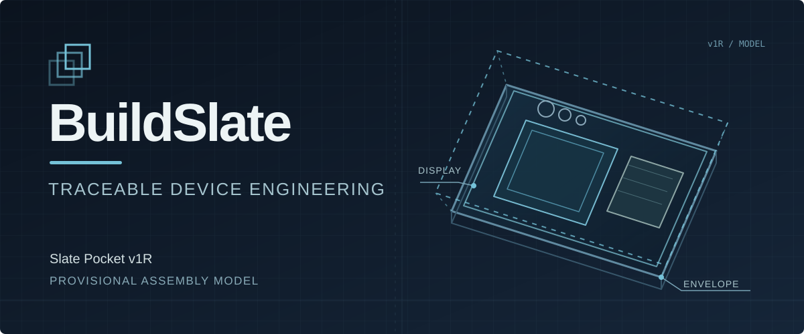

# BuildSlate

[](https://github.com/superflyad/BuildSlate/actions/workflows/validation.yml)
[](https://github.com/superflyad/BuildSlate/releases/latest)
[](LICENSE.txt)



BuildSlate connects specifications, assumptions, evidence, models, and gate decisions for the proposed Slate Pocket v1R device. It provides a traceable Python CLI and a local 3D assembly viewer.

**Public site:** [Explore the baseline 3D model](https://superflyad.github.io/BuildSlate/) · [View the 128 GB placement study](https://superflyad.github.io/BuildSlate/?model=memory8) · [Inspect CAD proof](https://superflyad.github.io/BuildSlate/?tab=proof) · [Review hardware readiness](https://superflyad.github.io/BuildSlate/?tab=hardware). The site is published from `main` after validation and CAD export pass. Its interactive models are read-only; the [STEP exports](cad/slate-pocket-v1r/concept-cad/README.md) are editable concept geometry. Neither is a released device design.

## Start here

- **Review the program:** [current dashboard](reports/program/dashboard.md) and `buildslate blockers`
- **Explore the model:** [live CAD viewer](https://superflyad.github.io/BuildSlate/), [geometry proof](https://superflyad.github.io/BuildSlate/?tab=proof), and [assembly contract](engineering/assembly/README.md)
- **Understand the system:** [architecture](ARCHITECTURE.md) and [documentation index](docs/README.md)
- **Contribute:** [repository standards](docs/standards/repository.md) and [contribution guide](CONTRIBUTING.md)

**Hardware status: no build package and no functional device proof.** The [editable concept CAD](cad/slate-pocket-v1r/concept-cad/README.md) has a 41-solid baseline and a 45-solid eight-package memory alternative, both with assumed placements. v1R has zero selected parts in its sourcing strategy, no released electrical or mechanical design, and no measured integrated prototype. A builder cannot use these files to make a demonstrated working phone. See the [build-to-function gate](docs/engineering/build_to_function.md), run `buildslate hardware`, or open the public viewer's [Hardware tab](https://superflyad.github.io/BuildSlate/?tab=hardware). The [dashboard](reports/program/dashboard.md) tracks the wider program blockers. Software release [v0.1.0](https://github.com/superflyad/BuildSlate/releases/tag/v0.1.0) does not change the hardware status.

The [firmware release proof](docs/engineering/firmware_release_proof.md) now checks image bytes, boot and recovery order, driver coverage, and BOM/board bindings before the hardware gate can accept a firmware record. The public Hardware tab reports the bundle as missing. This is release integrity checking; no Slate Pocket firmware has been booted.

The [schematic ERC proof](docs/engineering/schematic_erc_proof.md) reruns KiCad electrical rules from an editable source and pinned project settings before an ERC record can count toward design release. The v1R schematic and reviewed ERC report are still missing.

The [routed PCB proof](docs/engineering/routed_pcb_proof.md) now binds those same KiCad settings to DRC, schematic parity, and complete copper-layer exports. There is still no released board to fabricate.

The [power safety proof](docs/engineering/power_safety_proof.md) checks a released pack's recorded limits against charge settings, complete subsystem loads, rail capacity, battery current, and fault-control declarations. It binds the analysis to the selected BOM, electrical BOM, and routed board. The [public Hardware view](https://superflyad.github.io/BuildSlate/?tab=hardware) reports this release as missing; no battery or power circuit is selected or physically verified.

The [thermal release proof](docs/engineering/thermal_release_proof.md) checks a geometry-bound model and raw solver results for material and boundary source coverage, all required operating cases, heat balance, mesh convergence, and supplier temperature limits. The public Hardware view reports this release as missing. The model is not built, and no Slate Pocket thermal behavior has been measured.

The approved 128 GB memory floor is retained. Qualcomm publishes an X2 controller maximum at or above that capacity; its public example is 48 GB, and no qualified 128 GB Slate topology is available. The [compute path](docs/engineering/compute_platform_decision.md) identifies the specific supplier and physical proof still required.

The [memory package screen](docs/engineering/memory_package_fit.md) compares the four assumed 32 GB sites with an exact public 16 GB LPDDR5X package. Eight of those would be needed for 128 GB, and their dimensions do not fit the current memory rectangles. The CAD sites remain planning geometry.

A separate [eight-package placement study](engineering/pcb/slate-pocket-v1r-floorplan/memory-8x16-study.yaml) puts four public-reference package outlines on each board side. The [editable STEP alternative](cad/slate-pocket-v1r/concept-cad/memory-8x16.step) and [public 3D model](https://superflyad.github.io/BuildSlate/?model=memory8) show those boxes inside the whole assembly. Its planar boxes clear the other current planning blocks by at least 1.5 mm under an assumed 1.0 mm rule. The floorplan, mechanical model, and compute stack now share a provisional 0.8 mm PCB thickness; fabricator review, memory routing, and controller topology are still missing. The [public Hardware view](https://superflyad.github.io/BuildSlate/?tab=hardware) shows this distinction.

The [1 TB UFS candidate screen](docs/engineering/storage_candidate_fit.md) ties one exact KIOXIA part to its public package outline and voltage requirements. Its nominal outline fits the concept board, while the required storage rails, host support, and routed design remain unproven. The result is visible on the site's [Hardware tab](https://superflyad.github.io/BuildSlate/?tab=hardware).

The [battery candidate fit](docs/engineering/battery_candidate_fit.md) shows that the public AI1-M01 bare-cell box is already larger than the current complete-pack allocation. Its listed 2C category is for discharge; the candidate has no published charge limit. The battery and 100 W charging target therefore remain unresolved.

The [camera path proof](docs/engineering/cad_proofing.md) screens assumed pupil cylinders through three concept layers: the rear cover, display stack, and touch film. The revised model has a 5.0 mm rear opening and 3.1 mm front punch-hole, providing 0.84 mm and 0.54 mm nominal radial margins respectively. The [public Proof view](https://superflyad.github.io/BuildSlate/?tab=proof) reports exact solid overlap for each layer. Neither camera has a supplier-qualified optical path, cover seal, or measured image performance.

## Get started

Use a checkout of this repository with Python 3.12 or newer. Node.js 20.19 or newer is needed for the viewer and the full validation gate.

```bash
git clone https://github.com/superflyad/BuildSlate.git
cd BuildSlate
python -m pip install -e .
buildslate validate
buildslate status
buildslate blockers
buildslate hardware
```

The package contains CLI code, not the engineering input files. From another working directory, point an installed CLI at a checkout:

```bash
buildslate --repo-root /path/to/BuildSlate status
```

The [v0.1.0 release](https://github.com/superflyad/BuildSlate/releases/tag/v0.1.0) provides a wheel, source distribution, and static viewer archive. No PyPI publication is configured.

## Inspect the assembly

```bash
python -m buildslate.assembly --check
python validation/validate_concept_cad.py
cd viewer
npm ci
npm run dev
```

Open the local address printed by Vite. The baseline concept CAD is the default view; switch to **128 GB study** for the two-sided reference package alternative or **Source envelopes** for the original planning model. Drag to rotate, select a part to inspect its source and evidence class, and use section cuts, isolation, or explode to examine the internal arrangement. The Program tab includes all 22 component library roles and their source evidence status. The [viewer guide](viewer/README.md) covers the controls and generated assets. The viewer cannot establish physical fit or qualification.

The same viewer is published from `main` at [superflyad.github.io/BuildSlate](https://superflyad.github.io/BuildSlate/) after the validation and CAD export jobs pass. Its [Proof tab](docs/engineering/cad_proofing.md) reports CAD integrity, exact nominal intersections, keepout conflicts, and local stack screens for every concept solid.

## How a change moves through the repository

1. Locate the authoritative input using the [repository map](#repository-map) and [standards](docs/standards/repository.md).
2. Ask `buildslate impact --changed <repository-relative-path>` which generated nodes depend on it.
3. Change the input and record any changed authority or engineering decision in [DECISIONS.md](DECISIONS.md).
4. Run `buildslate regenerate --stale`, then review the generated diff.
5. Run the focused validator while editing. After committing, run `python scripts/ci_validate.py` from a clean tree. The gate checks all validators, Python and Markdown style, installed-package behavior, generated currency, and the viewer build.

Generated reports and the viewer's `assembly` and `concept` JSON/glTF files are outputs. Edit their source files, then regenerate. The concept CAD also requires `python -m buildslate.cad` in the [Python 3.12 CAD environment](cad/slate-pocket-v1r/concept-cad/README.md). Supplier responses and physical test results follow the [controlled intake workflow](docs/engineering/operator_workflows.md).

## Repository map

- `specs/` and `configs/` hold product targets and device profiles.
- `engineering/`, `cad/`, and `simulations/` hold model inputs, calculations, and provisional geometry.
- `research/` holds candidate research, RFQs, and supplier response intake.
- `validation/` and `manufacturing/` hold validators, tests, and pilot workflows.
- `buildslate/` contains the Python model, generation engine, and CLI.
- `viewer/` contains the static browser app and generated assembly assets.
- `reports/` contains generated reviews; `docs/` holds methods and procedures.

The [program manifest](engineering/program/program_model.yaml) maps graph authorities. The [regeneration manifest](engineering/program/regeneration.yaml) maps generated dependencies. The [documentation index](docs/README.md) provides a task-based route through the detailed guides.

## Project information

- [Roadmap](ROADMAP.md) — delivered scope, missing evidence, and future viewer work
- [Changelog](CHANGELOG.md) and [release process](docs/standards/releases.md) — software versions and artifacts
- [Contributing](CONTRIBUTING.md) — setup, change workflow, and validation
- [Support](SUPPORT.md) and [security policy](SECURITY.md) — issue and private reporting routes
- [MIT license](LICENSE.txt)
